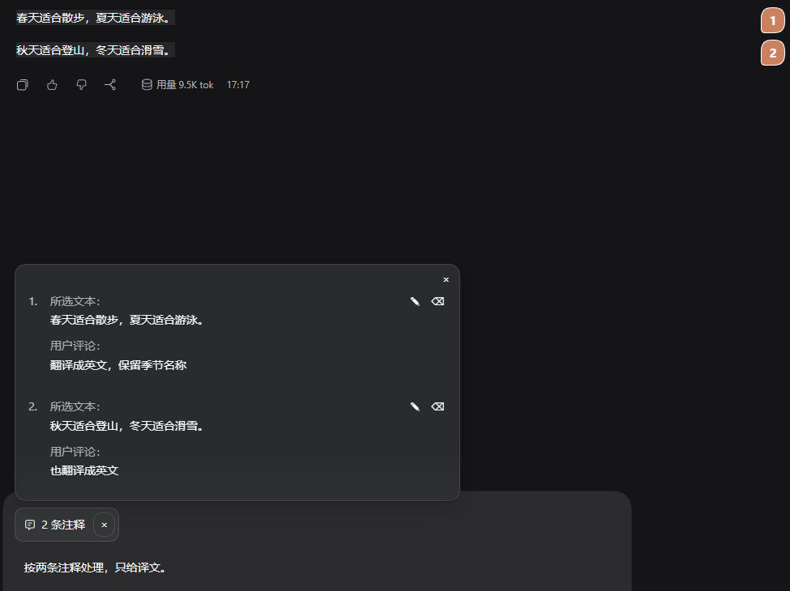
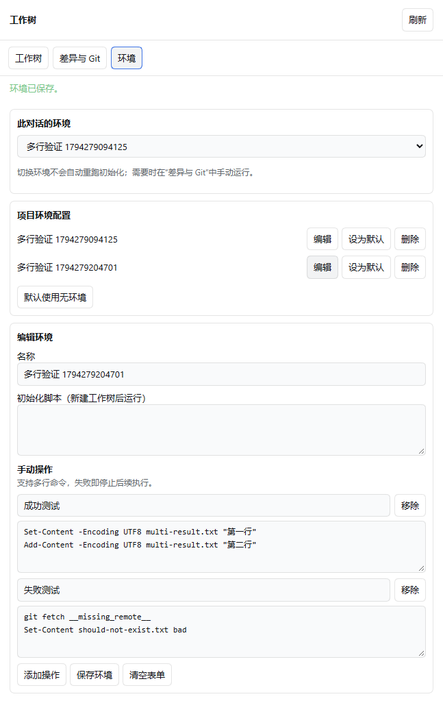
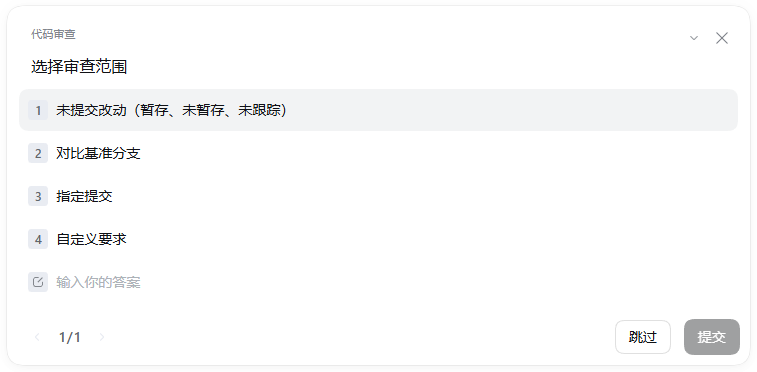

# DSH CDX Plus — 为 DSH 补齐 Codex 风格体验

npm：`dsh-asuta-cdx-plus` · GitHub：`Asuta/dsh-cdx-plus`

**DeepSeek Harness（DSH）插件合集：18 项功能，按需开启或关闭。**

习惯了 Codex 的交互方式，希望在 DSH 中使用选中引用、侧边对话、工作树环境和代码审查？DSH CDX Plus 将这些增强能力整理为一个合集，让你更快配置熟悉的开发工作流。

**Codex-inspired plugins for DeepSeek Harness:** selection quotes, side chats, Git worktrees and code review.

[English](README_EN.md) · [安装与发布状态](RELEASE_STATUS.md) · [反馈问题](https://github.com/Asuta/dsh-cdx-plus/issues)

## 实现有参考，体验有验证

部分功能的交互逻辑与实现思路，参考了对 **Codex 桌面版反编译代码的分析**，再结合 DSH 的插件机制进行适配。我们关注操作流程和行为细节，让熟悉 Codex 的用户在 DSH 中也能顺手使用这些能力。

实现过程中结合聚焦测试与真实界面验收，已验证的场景包括侧栏双向滚动、代码审查范围选择和工作树命令输出。具体覆盖范围见[发布状态](RELEASE_STATUS.md)。流畅性和稳定性是持续优化目标；实际性能仍取决于 DSH 版本、项目规模和运行环境，不作与 Codex 等同的性能承诺。

## 你想做什么？

| 使用场景 | 对应能力 |
| --- | --- |
| 针对回答中的几句话追问 | 选中文字添加引用和批注；可一次整理多处引用后统一发送 |
| 讨论一个支线问题，保留主对话进度 | 在右侧打开继承上下文的侧边对话；隐藏历史只影响显示 |
| 从当前对话尝试另一条开发路线 | 创建 Git 工作树，按需带入未提交改动与 .worktreeinclude 文件 |
| 给不同工作树准备开发环境 | 多份环境配置、setup 脚本、快捷命令与可见的内置终端输出 |
| 提交前检查改动 | /review 选择审查范围，由独立子代理输出优先级和文件位置；旁边查看 Git diff |
| 整理越来越多的项目与对话 | 置顶、统一侧栏滚动、移动对话、归档管理和 Agent 对话搜索工具 |

## 功能展示

以下为实际验收界面的裁剪截图，使用演示内容；界面细节可能随 DSH 版本变化。图片来源与处理说明见[截图说明](docs/images/README.md)。

### 选中引用与批注

选择回答片段，给每段添加评论，再从输入框统一发送。需要展开支线时，可联动侧边对话。

### 工作树环境与多行命令

为项目保存多份环境；初始化脚本和手动命令在对应工作树目录执行，并打开内置终端显示过程。多行命令默认失败即停止后续执行。

### Codex 风格代码审查

输入 /review 后，先选择未提交改动、基准分支、指定提交或自定义要求，再启动审查。

## 安装与快速开始

**本仓库版本 0.1.4，适配基线 DSH 0.2.2-rc.3。** 下方命令安装 npm 上的最新正式版本；各版本的发布情况见 [RELEASE_STATUS.md](RELEASE_STATUS.md)。

0.1.4 支持 DSH 0.2.2-rc.2 和 0.2.2-rc.3，目前是本地适配候选，尚未发布到 npm。npm 的 0.1.3 仅支持 rc.2；rc.3 请使用下方的本地合集方式，或等待新版正式发布。

    dsh plugin --profile desktop add dsh-asuta-cdx-plus

安装后打开「插件 → DSH CDX Plus」，按需启停各组件。只需要某一项功能时，也可单独安装下方的子包。

建议先体验三个入口：

1. 选中一段助手回答，添加引用评论或在侧边对话中追问。
2. 打开 Git 项目，在工作树面板配置环境，再从「变更」旁的运行菜单执行命令。
3. 在项目对话中输入 /review，选择范围并确认审查。

现在想试用：从发行源码生成本地合集

需要 Git、Node.js 24+（含 npm）及 DSH 0.2.2-rc.3。克隆本公开发行仓库，生成本地试用包：

    git clone https://github.com/Asuta/dsh-cdx-plus.git
    cd dsh-cdx-plus
    node scripts/pack.mjs --local-preview

脚本最后会输出一个全新的本地合集 .tgz 路径，同时准备它依赖的 18 个子包。这个目录需要保留；不能只把合集 .tgz 单独发给别人。

为避免影响正在使用的配置，先在新 PowerShell 窗口中设置独立数据目录，然后安装到测试 web profile：

    $env:DSH_HOME = Join-Path ([IO.Path]::GetTempPath()) ('dsh-cdx-plus-preview-' + [guid]::NewGuid().ToString('N'))
    dsh plugin --profile web add "<脚本最后输出的合集 .tgz 绝对路径>"
    dsh web

打开启动命令给出的本地地址并配置模型。关闭此 PowerShell 窗口即可结束这次环境变量设置；测试数据仍留在临时目录。浏览器控制功能需要 Electron 桌面宿主，不能在此网页版试用中完整验证。

本地合集仅供试用，不是可发布的 npm 产物。正式发布后，使用上方 npm 安装方式。

## 全部 18 项功能

每个组件都有独立开关；部分组合功能需要同时启用相关组件，例如引用跳转侧边对话、Agent 移动会话。

| 功能 | 能做什么 | 独立包名 |
| --- | --- | --- |
| [归档会话管理](packages/archived-sessions/) | 集中查找、恢复和删除已归档的 DSH 对话。 | dsh-asuta-archived-sessions |
| [代码审查](packages/codex-review/) | 在 DSH 中用 /review 选择审查范围，由独立子代理输出带优先级和文件行号的 Codex 风格报告。 | dsh-asuta-codex-review |
| [对话管理工具](packages/conversation-workbench/) | 让 DSH Agent 按需查找和读取对话、管理工作区、移动会话并查询 PR 检查结果。 | dsh-asuta-conversation-workbench |
| [桌面导航](packages/desktop-navigation/) | 从 DSH 对话打开本地文件路径，并通过双击重命名最近对话。 | dsh-asuta-desktop-navigation |
| [Mermaid 图表](packages/dsh-mermaid-renderer/) | 在 DSH 对话中将 Mermaid 代码渲染为可阅读的图表。 | dsh-asuta-mermaid-renderer |
| [内置浏览器](packages/dsh-sidebrowser/) | 在 DSH 桌面侧栏中浏览网页，让 Agent 操作页面并检查控制台、网络和样式。 | dsh-asuta-sidebrowser |
| [Git 变更](packages/git-diff/) | 在 DSH 对话旁查看暂存、未暂存、未提交改动及分支差异。 | dsh-asuta-git-diff |
| [隐藏新会话按钮](packages/hide-new-session/) | 隐藏 DSH 侧栏顶部的新会话按钮，精简导航区域。 | dsh-asuta-hide-new-session |
| [历史消息编辑](packages/history-edit/) | 编辑 DSH 对话中的纯文本历史消息并重新生成回复。 | dsh-asuta-history-edit |
| [项目活动状态](packages/project-activity/) | 在折叠的 DSH 项目标题旁显示对话运行状态。 | dsh-asuta-project-activity |
| [无工作区对话](packages/projectless-chat/) | 新建不绑定工作区的 DSH 对话，并配置默认工作目录。 | dsh-asuta-projectless-chat |
| [记忆思考强度](packages/reasoning-effort-memory/) | 按提供商和模型记住 DSH 上次使用的思考强度。 | dsh-asuta-reasoning-effort-memory |
| [选中引用](packages/selection-quote/) | 在 DSH 中选中文字添加引用和批注，汇总引用清单，并联动侧边对话。 | dsh-asuta-selection-quote |
| [移动对话](packages/session-mover/) | 将空闲 DSH 对话拖到其他工作区，支持精确落位和撤销。 | dsh-asuta-session-mover |
| [侧边对话](packages/sidebar-chat/) | 在 DSH 右侧开启继承主对话上下文的独立侧边对话，支持隐藏历史显示与转为独立会话。 | dsh-asuta-sidebar-chat |
| [侧栏整理](packages/sidebar-more/) | 精简 DSH 侧栏入口，让置顶、工作区与最近对话共用滚动区域。 | dsh-asuta-sidebar-more |
| [Agent 设置](packages/user-agent-settings/) | 在 DSH 设置页编辑全局 Agent 指令、选择压缩模型并刷新前端。 | dsh-asuta-user-agent-settings |
| [工作树控制](packages/worktree-control/) | 为 DSH 对话创建 Git 工作树，支持 .worktreeinclude、多份环境、setup 脚本和可见终端命令。 | dsh-asuta-worktree-control |

## 常见问题

### 如何让 DSH 获得 Codex 风格的交互？

本合集提供选中引用、侧边对话、工作树环境、代码审查等增强。你可以根据自己的使用习惯逐项开启，保留 DSH 的模型配置与原生会话。

### 需要 Codex 账号或订阅吗？

本合集本身不要求 Codex 账号或订阅。对话、侧边对话与审查使用你在 DSH 中配置的模型；模型服务的凭据、权限和费用仍由对应提供商决定。

### 能只开启工作树功能吗？

可以。安装合集后关闭其他组件，或在子包发布后单独安装工作树控制。工作树能力要求可用的 Git 仓库；环境命令还需要启用 DSH 内置终端，并提供 Node.js 和对应 shell。支持 .worktreeinclude、多份本地环境和可选 setup 脚本。

### 隐藏侧边对话的历史，会丢掉上下文吗？

不会。隐藏只作用于显示，已继承的上下文保留；设置可以即时影响已有侧边对话。

### 这是官方 Codex 或 DeepSeek 插件吗？

这是独立社区项目，部分交互设计受 Codex 启发，与 OpenAI、DeepSeek 均无官方隶属或背书关系。各功能按 DSH 的能力实现；代码审查结果等细节与 Codex 原生界面可能不同。

### 升级 DSH 后能继续用吗？

当前声明的适配基线为 DSH 0.2.2-rc.3，不代表所有未来版本都已兼容。安装前查看[发布状态](RELEASE_STATUS.md)；反馈问题时请附 DSH 版本、插件版本和复现步骤，并隐去私密信息。

## 维护与贡献

本仓库包含干净的发行插件、可重建源码和运行资源。它由开发仓库自动导出；开发技能、现场笔记和本机配置不进入发行仓库。建议通过 [Issues](https://github.com/Asuta/dsh-cdx-plus/issues) 提交问题与功能建议，便于同步回开发源。

维护者验证：

    node scripts/verify.mjs
    node scripts/pack.mjs

各子包保留自己的许可证和第三方声明；新增自有代码及合集采用 MIT。详见各包 LICENSE / NOTICE 与 [RELEASE_STATUS.md](RELEASE_STATUS.md)。
