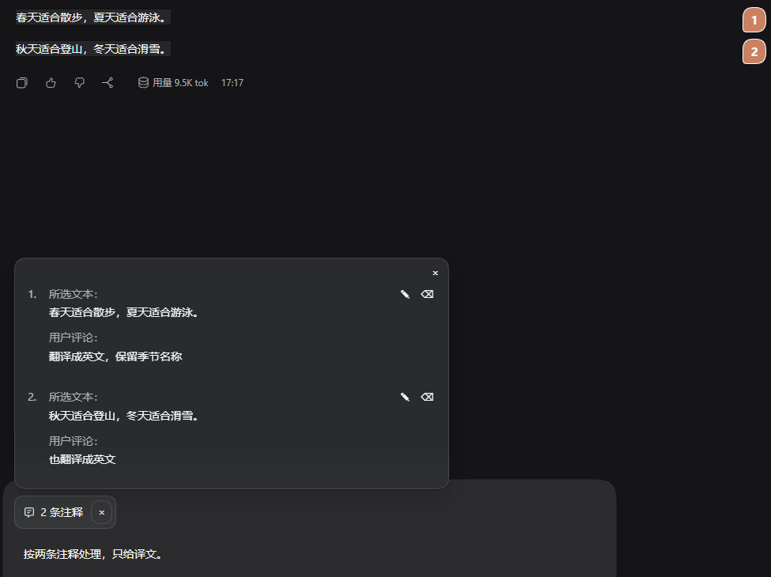
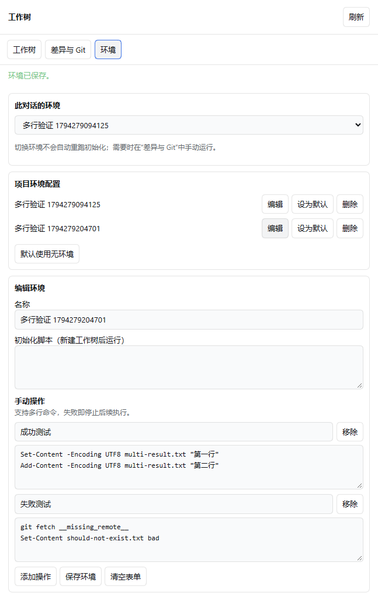
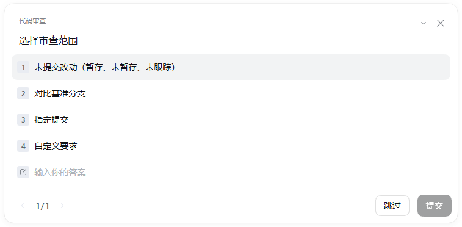

# DSH CDX Plus — Codex-inspired workflows for DSH

**A DeepSeek Harness plugin suite with 18 independently switchable features.**

Bring familiar Codex-style interactions to DeepSeek Harness (DSH): quote selected text, explore a question in a side chat, create Git worktrees with local environments, and review code with an independent agent.

[中文](README.md) · [Release status](RELEASE_STATUS.md) · [Report an issue](https://github.com/Asuta/dsh-cdx-plus/issues)

## Informed implementation, verified interactions

Some interaction logic and implementation approaches draw on **analysis of decompiled Codex desktop code**, adapted to DSH's plugin mechanisms. We focus on workflows and behavioral details so people familiar with Codex can use these features comfortably in DSH.

Development combines focused tests with real UI acceptance checks. Verified scenarios include bidirectional sidebar scrolling, review scope selection and visible worktree command output; see [release status](RELEASE_STATUS.md) for coverage. Responsiveness and stability remain ongoing goals. Actual performance depends on the DSH version, project size and runtime environment; we do not claim performance parity with Codex.

## What would you like to do?

| Your workflow | What the suite adds |
| --- | --- |
| Ask about a specific part of a response | Select text, attach comments and send several quotes together |
| Explore a side question while keeping your main conversation | Open a side chat with inherited context; hide old messages without removing that context |
| Try another implementation from the current conversation | Create a Git worktree and optionally copy uncommitted changes and files selected by .worktreeinclude |
| Prepare different development environments | Save multiple environments with setup scripts and manual commands; watch output in the built-in terminal |
| Review changes before committing | Use /review to select a scope and get findings with priorities and file locations; inspect Git diffs alongside the chat |
| Keep projects and conversations organized | Pin chats, scroll sidebar sections together, move and archive conversations, and let agents find existing chats |

## See the features

These are cropped screenshots from actual acceptance checks using demo content. UI details may differ by DSH version. See the [image notes](docs/images/README.md).

### Selection quotes and annotations

Comment on individual passages, collect quotes, and send them through the conversation composer. The side-chat integration lets you explore a passage separately.

### Worktree environments and multiline commands

Store multiple project environments, setup scripts and manual actions. Commands run in the relevant worktree and open the built-in terminal with visible output; multiline commands stop on errors by default.

### Codex-style code review

Enter /review and select uncommitted changes, a base branch, a specific commit or custom instructions before starting the review.

## Install and get started

**Current version: 0.1.2. Compatibility baseline: DSH 0.2.2-rc.2. The suite and all feature packages are published on npm.** See [RELEASE_STATUS.md](RELEASE_STATUS.md) for release status by version.

    dsh plugin --profile desktop add dsh-asuta-cdx-plus

Open Plugins → DSH CDX Plus and enable the components you want. Individual packages can also be installed separately.

Start with three workflows:

1. Select part of an assistant response and add a quote comment or open a side chat.
2. In a Git project, configure an environment in the worktree panel, then run a command from the menu beside Changes.
3. Enter /review in a project conversation, select a scope and confirm the review.

Try it now: build a local suite from the release source

Requires Git, Node.js 24+ with npm, and DSH 0.2.2-rc.2.

    git clone https://github.com/Asuta/dsh-cdx-plus.git
    cd dsh-cdx-plus
    node scripts/pack.mjs --local-preview

The last output line names a fresh local suite .tgz. Keep its directory and all 18 sibling feature tarballs: the preview uses local dependencies and cannot be shared as a single tarball.

In a new PowerShell window, use a separate data directory and install into a test web profile:

    $env:DSH_HOME = Join-Path ([IO.Path]::GetTempPath()) ('dsh-cdx-plus-preview-' + [guid]::NewGuid().ToString('N'))
    dsh plugin --profile web add "<absolute suite .tgz path printed by the script>"
    dsh web

Open the local address printed by DSH and configure a model. Closing this PowerShell window ends the environment-variable setting; the test data remains in the temporary directory. Embedded browser control requires the Electron desktop host and cannot be fully tested in this web preview.

The local suite is private and intended only for testing. Use the npm installation above when the release becomes available.

## All 18 features

Each component has its own switch. Some integrations need both components enabled, such as opening a side chat from a quote or moving a conversation through agent tools.

| Feature | What it does | Package |
| --- | --- | --- |
| [Archived conversations](packages/archived-sessions/) | Find, restore and delete archived DSH conversations. | dsh-asuta-archived-sessions |
| [Code review](packages/codex-review/) | Run /review in DSH with scope selection and an independent agent producing Codex-style findings with priorities and file locations. | dsh-asuta-codex-review |
| [Conversation tools](packages/conversation-workbench/) | Give DSH agents on-demand tools to find and read conversations, manage workspaces, move sessions and inspect PR checks. | dsh-asuta-conversation-workbench |
| [Desktop navigation](packages/desktop-navigation/) | Open local file paths from DSH conversations and rename recent chats with a double click. | dsh-asuta-desktop-navigation |
| [Mermaid diagrams](packages/dsh-mermaid-renderer/) | Render Mermaid code as readable diagrams in DSH conversations. | dsh-asuta-mermaid-renderer |
| [Embedded browser](packages/dsh-sidebrowser/) | Browse in the DSH desktop sidebar and let agents operate pages and inspect console, network and styles. | dsh-asuta-sidebrowser |
| [Git changes](packages/git-diff/) | Inspect staged, unstaged, uncommitted and branch diffs beside a DSH conversation. | dsh-asuta-git-diff |
| [Hide new-chat button](packages/hide-new-session/) | Hide the new-chat button at the top of the DSH sidebar for a simpler navigation area. | dsh-asuta-hide-new-session |
| [Edit message history](packages/history-edit/) | Edit plain-text message history in DSH and regenerate the response. | dsh-asuta-history-edit |
| [Project activity](packages/project-activity/) | Show conversation activity beside collapsed DSH project headings. | dsh-asuta-project-activity |
| [Chats without a workspace](packages/projectless-chat/) | Start DSH conversations outside a workspace and configure their default working directory. | dsh-asuta-projectless-chat |
| [Remember reasoning effort](packages/reasoning-effort-memory/) | Remember the last DSH reasoning-effort setting for each provider and model. | dsh-asuta-reasoning-effort-memory |
| [Selection quotes](packages/selection-quote/) | Quote selected text, add annotations and browse a quote list in DSH, with optional side-chat integration. | dsh-asuta-selection-quote |
| [Move conversations](packages/session-mover/) | Drag idle DSH conversations into another workspace with precise placement and undo. | dsh-asuta-session-mover |
| [Side conversations](packages/sidebar-chat/) | Open independent DSH side conversations with inherited context, optional history hiding and conversion to standalone chats. | dsh-asuta-sidebar-chat |
| [Sidebar organization](packages/sidebar-more/) | Simplify DSH sidebar navigation and scroll pinned chats, workspaces and recent conversations together. | dsh-asuta-sidebar-more |
| [Agent settings](packages/user-agent-settings/) | Edit global agent instructions, choose a compaction model and refresh the frontend from DSH settings. | dsh-asuta-user-agent-settings |
| [Worktrees and environments](packages/worktree-control/) | Create Git worktrees for DSH chats with .worktreeinclude, multiple environments, setup scripts and visible terminal commands. | dsh-asuta-worktree-control |

## Frequently asked questions

### How can I add Codex-style features to DeepSeek Harness?

Enable the suite's quotes, side chats, worktree environments or code review as needed. Your DSH model configuration and native conversations remain the basis of these workflows.

### Do I need a Codex account or subscription?

The suite itself does not require one. Chat, side conversations and review use models configured in DSH. Provider credentials, permissions and charges still apply to those models.

### Can I enable only Git worktree management?

Yes. Disable the other suite components, or install the worktree package alone after publication. Worktrees require a usable Git repository; environment commands also require the DSH built-in terminal, Node.js and the appropriate shell. The plugin supports .worktreeinclude, multiple environments and optional setup scripts.

### Does hiding side-chat history remove its context?

No. Hiding affects display only, and the inherited context remains available. The setting also applies immediately to existing side chats.

### Is this an official OpenAI or DeepSeek product?

This is an independent community project inspired in part by Codex interactions. It is not affiliated with or endorsed by OpenAI or DeepSeek. Features are implemented on DSH, and details such as review presentation can differ from the native Codex UI.

### Can I use it with a newer DSH version?

The declared baseline is DSH 0.2.2-rc.2; future versions are not automatically verified. Check [release status](RELEASE_STATUS.md) before installing. Include DSH and plugin versions plus reproduction steps in bug reports, with private information removed.

## Maintenance and contributions

This generated release repository contains plugins, rebuildable source and runtime resources. Development skills, local notes and machine configuration stay in the development repository. Use [Issues](https://github.com/Asuta/dsh-cdx-plus/issues) for feedback so changes can be carried back to the development source.

Maintainer checks:

    node scripts/verify.mjs
    node scripts/pack.mjs

Existing MIT, Apache-2.0 and third-party notices remain with their packages. Newly licensed owned code and the suite use MIT. Consult each package's LICENSE / NOTICE and [RELEASE_STATUS.md](RELEASE_STATUS.md).
